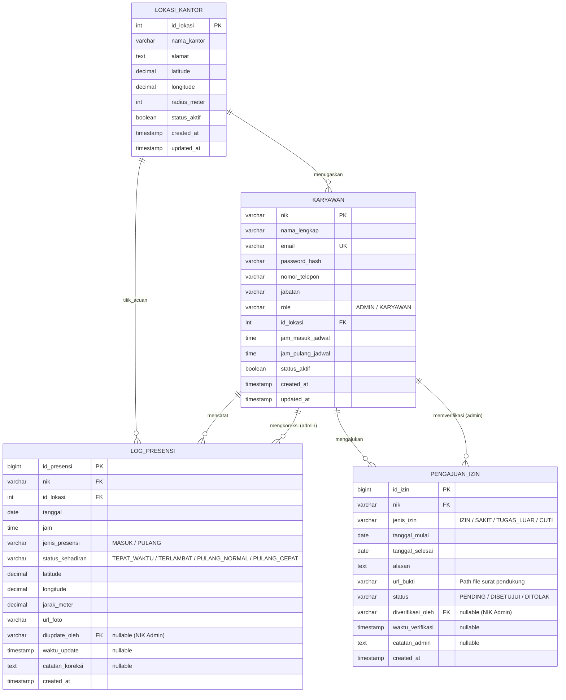

# DOKUMEN TAHAP 1: ANALISIS SISTEM (PRD & ERD)
## SISTEM MANAJEMEN ABSENSI BERBASIS WEB

> **Mata Kuliah:** Rekayasa Perangkat Lunak  
> **Program Studi:** S1 Teknik Informatika, Fakultas Teknik, Universitas Tadulako  
> **Tahun:** 2026  
> **Disusun Oleh (Kelompok 10):**
> 1. Ilham Arifin (F5512530109)
> 2. Andiardi (F5512530110)
> 3. Dian Abdillah Melosovic (F5512530112)

---

## 1. Executive Summary & Problem Statement

### 1.1 Latar Belakang & Masalah
Pencatatan kehadiran karyawan konvensional menghadapi berbagai keterbatasan operasional:
1. **Mesin Fingerprint:** Rentan terhadap kendala sensor kotor/rusak, antrean fisik saat jam sibuk, dan biaya pengadaan/pemeliharaan perangkat keras yang tinggi.
2. **Kartu RFID:** Sangat rentan terhadap praktik penitipan absensi (*buddy punching*) antar rekan kerja.
3. **Face Recognition Standalone:** Biaya implementasi perangkat dedicated sangat mahal dan tidak fleksibel untuk model kerja dinamis/multi-lokasi.

### 1.2 Solusi yang Dikembangkan
**Sistem Manajemen Absensi Berbasis Web** menyediakan solusi pencatatan kehadiran terdesentralisasi melalui peramban (*web browser*) pada perangkat masing-masing pengguna dengan tiga pilar verifikasi otomatis:
- **Autentikasi Akun Terpusat:** Akun karyawan dikontrol dan didaftarkan langsung oleh pihak manajemen/HRD.
- **Validasi Geolocation (Geofencing):** Menghitung jarak pengguna secara waktu-nyata terhadap titik koordinat kantor cabang menggunakan formula *Haversine*. Absensi hanya diizinkan jika berada di dalam radius resmi kantor.
- **Validasi Swafoto Waktu Nyata (Live Camera WebRTC):** Mengunci pengambilan foto langsung melalui kamera peramban (tanpa unggah file dari galeri) sebagai bukti kehadiran fisik.
- **Pencatatan Waktu Otoritatif:** Waktu kehadiran (*timestamp*) dicatat langsung dari server, bukan dari jam lokal perangkat pengguna.

---

## 2. Arsitektur & Teknologi Terpilih

| Komponen | Teknologi | Keterangan |
| :--- | :--- | :--- |
| **Frontend** | React.js (JavaScript / TypeScript) | SPA responsif dengan dukungan WebRTC Camera API & HTML5 Geolocation API |
| **Backend** | Go (Golang) | High-performance, concurrent REST API & JWT Authentication |
| **Database** | PostgreSQL | Relational Database Management System (ACID Compliant) |
| **Penyimpanan Berkas** | Local Server Storage / Object Storage | Direktori khusus penyimpanan bukti swafoto dan surat bukti izin |

---

## 3. Persona Pengguna & Hak Akses (Role-Based Access Control)

| Peran (Role) | Deskripsi | Hak Akses Utama |
| :--- | :--- | :--- |
| **Admin / HRD** | Pengelola sistem dan manajemen sumber daya manusia | - Mendaftarkan dan mengelola akun karyawan<br>- Menentukan titik koordinat kantor dan batas radius (*geofencing*)<br>- Meninjau (*review*) dan menyetujui pengajuan izin/sakit<br>- Memantau rekapitulasi presensi harian seluruh karyawan<br>- Melakukan koreksi data kehadiran (*audit log*)<br>- Mengekspor laporan presensi ke format Spreadsheet (Excel/CSV) |
| **Karyawan** | Pengguna akhir yang melakukan presensi kerja | - Melakukan autentikasi (login)<br>- Melakukan presensi Masuk dan Pulang (GPS + Swafoto)<br>- Melihat riwayat kehadiran pribadi<br>- Mengajukan formulir Izin/Sakit/Tugas Luar dengan unggah bukti surat |

---

## 4. Kebutuhan Fungsional (Functional Requirements)

### FR-01: Manajemen Autentikasi & Akun
- **FR-01.1:** Sistem memverifikasi kredensial (*Email/NIK* dan *Password Hash*) menggunakan standar enkripsi bcrypt.
- **FR-01.2:** Sistem menerbitkan token sesi JWT (*JSON Web Token*) yang memuat klaim peran (*Role*).
- **FR-01.3:** Hanya Admin/HRD yang memiliki otorisasi untuk mendaftarkan akun karyawan baru, memperbarui informasi profil, mengatur jam kerja, dan menonaktifkan akun.

### FR-02: Manajemen Lokasi Kantor (*Geofencing*)
- **FR-02.1:** Admin/HRD dapat mendaftarkan beberapa titik cabang kantor dengan atribut: Nama Kantor, Koordinat Latitude, Longitude, dan Radius Batas (dalam meter).
- **FR-02.2:** Admin menugaskan setiap karyawan ke salah satu lokasi kantor acuan kerja.

### FR-03: Pencatatan Presensi Masuk & Pulang
- **FR-03.1 (Verifikasi Waktu):** Sistem memvalidasi waktu saat pengajuan dengan jadwal kerja karyawan:
  - Presensi Masuk: Membandingkan jam server dengan `jam_masuk_jadwal` + batas toleransi keterlambatan (15 menit). Menghasilkan status `TEPAT_WAKTU` atau `TERLAMBAT`.
  - Presensi Pulang: Membandingkan jam server dengan `jam_pulang_jadwal`. Menghasilkan status `PULANG_NORMAL` atau `PULANG_CEPAT`.
- **FR-03.2 (Verifikasi Geolocation):** Sistem menerima koordinat perangkat via HTML5 Geolocation API, menghitung jarak ke kantor acuan menggunakan formula *Haversine*. Jika `jarak <= radius_kantor`, sistem mengizinkan proses berlanjut; jika tidak, proses ditolak dengan pesan peringatan di luar radius.
- **FR-03.3 (Pengambilan Swafoto Langsung):** Sistem membuka kamera perangkat secara langsung (*live stream capture*) via `MediaDevices.getUserMedia()` dan menangkap 1 frame foto. Unggah berkas dari penyimpanan lokal/galeri dinonaktifkan.
- **FR-03.4 (Perekaman Log):** Sistem menyimpan data presensi secara atomik ke tabel database dan mengembalikan notifikasi keberhasilan kepada karyawan.

### FR-04: Pengajuan & Persetujuan Izin / Sakit / Tugas Luar
- **FR-04.1:** Karyawan dapat mengisi form ketidakhadiran dengan memilih jenis (`IZIN`, `SAKIT`, `TUGAS_LUAR`), menentukan rentang tanggal, menulis keterangan alasan, dan mengunggah berkas bukti (surat dokter / surat tugas format PDF/JPG/PNG).
- **FR-04.2:** Admin/HRD dapat meninjau daftar pengajuan yang masuk dan memberikan keputusan (`DISETUJUI` / `DITOLAK`) beserta catatan verifikasi.

### FR-05: Pemantauan Riwayat & Rekapitulasi Presensi
- **FR-05.1:** Karyawan dapat melihat daftar riwayat kehadiran pribadinya lengkap dengan tanggal, jam, status, dan thumbnail swafoto.
- **FR-05.2:** Admin/HRD dapat melihat tabel rekapitulasi kehadiran seluruh staf secara waktu-nyata dengan filter tanggal, departemen, dan lokasi kantor.
- **FR-05.3 (Audit Trail):** Jika Admin melakukan koreksi kehadiran, sistem wajib mencatat identitas admin pengubah (`diupdate_oleh`), waktu perubahan (`waktu_update`), dan alasan koreksi.

### FR-06: Manajemen Laporan & Ekspor Data
- **FR-06.1:** Admin/HRD dapat menyaring laporan kehadiran berdasarkan periode tanggal (awal & akhir) dan departemen.
- **FR-06.2:** Sistem menghitung kalkulasi agregasi: Total Hadir, Total Terlambat, Total Pulang Cepat, Total Izin/Sakit, dan Tanpa Keterangan (Alpha).
- **FR-06.3:** Admin/HRD dapat mengekspor hasil rekapitulasi kehadiran langsung ke format Spreadsheet (*Excel / CSV*).

---

## 5. Kebutuhan Non-Fungsional (Non-Functional Requirements)

| Kategori | Parameter | Spesifikasi |
| :--- | :--- | :--- |
| **Keamanan (Security)** | Enkripsi Kata Sandi | Menggunakan *bcrypt* dengan cost factor minimal 10. |
| | Otentikasi & Sesi | Menggunakan stateless JWT dengan waktu kadaluarsa (expired time) terdefinisi. |
| | Validasi Waktu | Wajib menggunakan *server timestamp* untuk mencegah manipulasi jam lokal perangkat. |
| | Akses Media Kamera | Menggunakan HTTPS untuk mengaktifkan izin `MediaDevices` di browser mobile modern. |
| **Performa (Performance)** | Waktu Respon API | Transaksi presensi harus selesai dalam waktu < 2.0 detik pada koneksi internet seluler standar. |
| **Keandalan (Reliability)** | Ketersediaan Data | Integritas transaksi basis data terjamin menggunakan prinsip ACID pada PostgreSQL. |
| **Portabilitas & UI** | Responsif Mobile | Antarmuka pengguna adaptif untuk tampilan layar smartphone (layar 360px ke atas) dan desktop. |

---

## 6. Logika Bisnis & Validasi (Business Logic Specification)

### 6.1 Formula Validasi Geolocation (Haversine Formula)
Untuk menghitung jarak nyata (\(d\)) antara koordinat pengguna \((\text{lat}_1, \text{lng}_1)\) dengan koordinat kantor \((\text{lat}_2, \text{lng}_2)\):

$$a = \sin^2\left(\frac{\Delta \text{lat}}{2}\right) + \cos(\text{lat}_1) \cdot \cos(\text{lat}_2) \cdot \sin^2\left(\frac{\Delta \text{lng}}{2}\right)$$
$$c = 2 \cdot \text{atan2}\left(\sqrt{a}, \sqrt{1-a}\right)$$
$$d = R \cdot c$$

*Keterangan:*  
- \(R\) = Radius bumi (\(\approx 6.371.000\text{ meter}\)).  
- \(\Delta \text{lat} = \text{lat}_2 - \text{lat}_1\) (dalam radian).  
- \(\Delta \text{lng} = \text{lng}_2 - \text{lng}_1\) (dalam radian).  
- **Kondisi Valid:** \(d \le \text{radius\_meter}\).

### 6.2 Aturan Validasi Waktu Presensi
- **Toleransi Keterlambatan Masuk:** 15 menit dari `jam_masuk_jadwal`.
  - Jika \(T_{\text{masuk}} \le \text{jam\_masuk\_jadwal} + 15\text{ menit}\) \(\rightarrow\) `TEPAT_WAKTU`
  - Jika \(T_{\text{masuk}} > \text{jam\_masuk\_jadwal} + 15\text{ menit}\) \(\rightarrow\) `TERLAMBAT`
- **Toleransi Kepulangan:**
  - Jika \(T_{\text{pulang}} < \text{jam\_pulang\_jadwal}\) \(\rightarrow\) `PULANG_CEPAT`
  - Jika \(T_{\text{pulang}} \ge \text{jam\_pulang\_jadwal}\) \(\rightarrow\) `PULANG_NORMAL`

---

## 7. Entity Relationship Diagram (ERD)

### 7.1 Visualisasi Relasi Entitas (Mermaid ERD)



---

## 8. Kamus Data Relasional (Data Dictionary)

### 8.1 Entitas `lokasi_kantor`
Menyimpan referensi koordinat fisik kantor untuk validasi geofencing.

| Kolom | Tipe Data | Constraint | Keterangan |
| :--- | :--- | :--- | :--- |
| `id_lokasi` | SERIAL | PRIMARY KEY | Identitas unik lokasi kantor |
| `nama_kantor` | VARCHAR(100) | NOT NULL | Nama kantor/cabang (cth: Kantor Pusat Palu) |
| `alamat` | TEXT | NOT NULL | Alamat fisik lengkap kantor |
| `latitude` | DECIMAL(10, 7) | NOT NULL | Koordinat garis lintang acuan kantor |
| `longitude` | DECIMAL(10, 7) | NOT NULL | Koordinat garis bujur acuan kantor |
| `radius_meter` | INT | NOT NULL DEFAULT 50 | Batas toleransi jarak maksimal dalam meter |
| `status_aktif` | BOOLEAN | NOT NULL DEFAULT TRUE | Status keaktifan kantor cabang |
| `created_at` | TIMESTAMP | DEFAULT CURRENT_TIMESTAMP | Waktu data dibuat |
| `updated_at` | TIMESTAMP | DEFAULT CURRENT_TIMESTAMP | Waktu pembaruan data |

### 8.2 Entitas `karyawan`
Menyimpan data master pengguna, akun, jadwal kerja, dan peran otorisasi.

| Kolom | Tipe Data | Constraint | Keterangan |
| :--- | :--- | :--- | :--- |
| `nik` | VARCHAR(30) | PRIMARY KEY | Nomor Induk Karyawan resmi |
| `nama_lengkap` | VARCHAR(150) | NOT NULL | Nama lengkap karyawan |
| `email` | VARCHAR(100) | UNIQUE, NOT NULL | Alamat email (digunakan untuk login) |
| `password_hash` | VARCHAR(255) | NOT NULL | Kata sandi terenkripsi (bcrypt) |
| `nomor_telepon` | VARCHAR(20) | NULL | Nomor kontak aktif |
| `jabatan` | VARCHAR(100) | NOT NULL | Posisi/jabatan kerja |
| `role` | VARCHAR(20) | NOT NULL | Nilai: `'ADMIN'` atau `'KARYAWAN'` |
| `id_lokasi` | INT | FK -> `lokasi_kantor` | Kantor cabang penugasan karyawan |
| `jam_masuk_jadwal`| TIME | NOT NULL DEFAULT '08:00:00'| Batas awal jadwal jam kerja masuk |
| `jam_pulang_jadwal`| TIME | NOT NULL DEFAULT '17:00:00'| Batas jadwal jam kerja pulang |
| `status_aktif` | BOOLEAN | NOT NULL DEFAULT TRUE | Status keaktifan status kepegawaian |
| `created_at` | TIMESTAMP | DEFAULT CURRENT_TIMESTAMP | Waktu pendaftaran akun |
| `updated_at` | TIMESTAMP | DEFAULT CURRENT_TIMESTAMP | Waktu pembaruan akun |

### 8.3 Entitas `log_presensi`
Menyimpan setiap transaksi presensi (Masuk & Pulang) beserta bukti foto dan koordinat.

| Kolom | Tipe Data | Constraint | Keterangan |
| :--- | :--- | :--- | :--- |
| `id_presensi` | BIGSERIAL | PRIMARY KEY | Identitas unik transaksi presensi |
| `nik` | VARCHAR(30) | FK -> `karyawan(nik)` | Karyawan yang melakukan presensi |
| `id_lokasi` | INT | FK -> `lokasi_kantor` | Lokasi acuan saat presensi dilakukan |
| `tanggal` | DATE | NOT NULL | Tanggal pencatatan (berdasarkan server) |
| `jam` | TIME | NOT NULL | Jam pencatatan (berdasarkan server) |
| `jenis_presensi`| VARCHAR(10) | NOT NULL | Nilai: `'MASUK'` atau `'PULANG'` |
| `status_kehadiran`| VARCHAR(20) | NOT NULL | `'TEPAT_WAKTU'`, `'TERLAMBAT'`, `'PULANG_NORMAL'`, `'PULANG_CEPAT'` |
| `latitude` | DECIMAL(10, 7) | NOT NULL | Koordinat latitude aktual pengguna |
| `longitude` | DECIMAL(10, 7) | NOT NULL | Koordinat longitude aktual pengguna |
| `jarak_meter` | DECIMAL(8, 2) | NOT NULL | Hasil kalkulasi jarak Haversine ke titik acuan |
| `url_foto` | VARCHAR(255) | NOT NULL | Path/URL berkas bukti swafoto |
| `diupdate_oleh` | VARCHAR(30) | NULL, FK -> `karyawan(nik)` | NIK Admin jika terjadi koreksi manual |
| `waktu_update` | TIMESTAMP | NULL | Waktu dilakukannya koreksi status |
| `catatan_koreksi`| TEXT | NULL | Catatan pertimbangan admin saat koreksi |
| `created_at` | TIMESTAMP | DEFAULT CURRENT_TIMESTAMP | Timestamp presensi dibuat |

### 8.4 Entitas `pengajuan_izin`
Menyimpan catatan izin, sakit, dinas luar, atau cuti beserta alur persetujuan HRD.

| Kolom | Tipe Data | Constraint | Keterangan |
| :--- | :--- | :--- | :--- |
| `id_izin` | BIGSERIAL | PRIMARY KEY | Identitas unik permohonan izin |
| `nik` | VARCHAR(30) | FK -> `karyawan(nik)` | Karyawan pemohon |
| `jenis_izin` | VARCHAR(20) | NOT NULL | Nilai: `'IZIN'`, `'SAKIT'`, `'TUGAS_LUAR'`, `'CUTI'` |
| `tanggal_mulai` | DATE | NOT NULL | Tanggal awal ketidakhadiran |
| `tanggal_selesai`| DATE | NOT NULL | Tanggal akhir ketidakhadiran |
| `alasan` | TEXT | NOT NULL | Uraian penjelasan permohonan izin |
| `url_bukti` | VARCHAR(255) | NULL | Tautan berkas bukti surat keterangan |
| `status` | VARCHAR(20) | NOT NULL DEFAULT 'PENDING' | Nilai: `'PENDING'`, `'DISETUJUI'`, `'DITOLAK'` |
| `diverifikasi_oleh`| VARCHAR(30)| NULL, FK -> `karyawan(nik)` | NIK Admin/HRD yang memverifikasi |
| `waktu_verifikasi`| TIMESTAMP | NULL | Waktu status persetujuan ditetapkan |
| `catatan_admin` | TEXT | NULL | Alasan penerimaan / penolakan |
| `created_at` | TIMESTAMP | DEFAULT CURRENT_TIMESTAMP | Waktu pengajuan diajukan |

---

## 9. Skema DDL Relasional (PostgreSQL Script)

```sql
-- 1. Tabel Lokasi Kantor
CREATE TABLE lokasi_kantor (
    id_lokasi SERIAL PRIMARY KEY,
    nama_kantor VARCHAR(100) NOT NULL,
    alamat TEXT NOT NULL,
    latitude DECIMAL(10, 7) NOT NULL,
    longitude DECIMAL(10, 7) NOT NULL,
    radius_meter INT NOT NULL DEFAULT 50,
    status_aktif BOOLEAN NOT NULL DEFAULT TRUE,
    created_at TIMESTAMP DEFAULT CURRENT_TIMESTAMP,
    updated_at TIMESTAMP DEFAULT CURRENT_TIMESTAMP
);

-- 2. Tabel Karyawan
CREATE TABLE karyawan (
    nik VARCHAR(30) PRIMARY KEY,
    nama_lengkap VARCHAR(150) NOT NULL,
    email VARCHAR(100) UNIQUE NOT NULL,
    password_hash VARCHAR(255) NOT NULL,
    nomor_telepon VARCHAR(20),
    jabatan VARCHAR(100) NOT NULL,
    role VARCHAR(20) NOT NULL CHECK (role IN ('ADMIN', 'KARYAWAN')),
    id_lokasi INT NOT NULL REFERENCES lokasi_kantor(id_lokasi),
    jam_masuk_jadwal TIME NOT NULL DEFAULT '08:00:00',
    jam_pulang_jadwal TIME NOT NULL DEFAULT '17:00:00',
    status_aktif BOOLEAN NOT NULL DEFAULT TRUE,
    created_at TIMESTAMP DEFAULT CURRENT_TIMESTAMP,
    updated_at TIMESTAMP DEFAULT CURRENT_TIMESTAMP
);

-- 3. Tabel Log Presensi
CREATE TABLE log_presensi (
    id_presensi BIGSERIAL PRIMARY KEY,
    nik VARCHAR(30) NOT NULL REFERENCES karyawan(nik) ON DELETE CASCADE,
    id_lokasi INT NOT NULL REFERENCES lokasi_kantor(id_lokasi),
    tanggal DATE NOT NULL,
    jam TIME NOT NULL,
    jenis_presensi VARCHAR(10) NOT NULL CHECK (jenis_presensi IN ('MASUK', 'PULANG')),
    status_kehadiran VARCHAR(20) NOT NULL CHECK (
        status_kehadiran IN ('TEPAT_WAKTU', 'TERLAMBAT', 'PULANG_NORMAL', 'PULANG_CEPAT')
    ),
    latitude DECIMAL(10, 7) NOT NULL,
    longitude DECIMAL(10, 7) NOT NULL,
    jarak_meter DECIMAL(8, 2) NOT NULL,
    url_foto VARCHAR(255) NOT NULL,
    diupdate_oleh VARCHAR(30) REFERENCES karyawan(nik),
    waktu_update TIMESTAMP,
    catatan_koreksi TEXT,
    created_at TIMESTAMP DEFAULT CURRENT_TIMESTAMP
);

-- Indexing untuk optimasi pencarian riwayat dan laporan
CREATE INDEX idx_presensi_nik_tanggal ON log_presensi(nik, tanggal);
CREATE INDEX idx_presensi_tanggal ON log_presensi(tanggal);

-- 4. Tabel Pengajuan Izin
CREATE TABLE pengajuan_izin (
    id_izin BIGSERIAL PRIMARY KEY,
    nik VARCHAR(30) NOT NULL REFERENCES karyawan(nik) ON DELETE CASCADE,
    jenis_izin VARCHAR(20) NOT NULL CHECK (jenis_izin IN ('IZIN', 'SAKIT', 'TUGAS_LUAR', 'CUTI')),
    tanggal_mulai DATE NOT NULL,
    tanggal_selesai DATE NOT NULL,
    alasan TEXT NOT NULL,
    url_bukti VARCHAR(255),
    status VARCHAR(20) NOT NULL DEFAULT 'PENDING' CHECK (status IN ('PENDING', 'DISETUJUI', 'DITOLAK')),
    diverifikasi_oleh VARCHAR(30) REFERENCES karyawan(nik),
    waktu_verifikasi TIMESTAMP,
    catatan_admin TEXT,
    created_at TIMESTAMP DEFAULT CURRENT_TIMESTAMP
);

CREATE INDEX idx_izin_nik ON pengajuan_izin(nik);
CREATE INDEX idx_izin_status ON pengajuan_izin(status);
```
