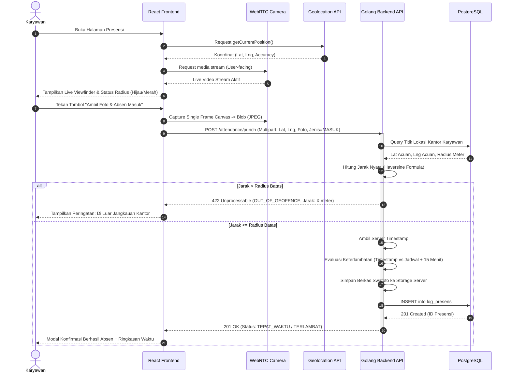
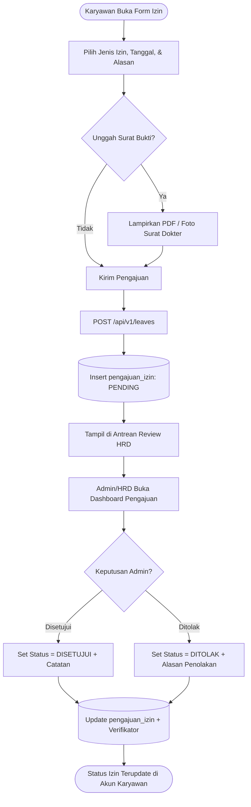

# DOKUMEN TAHAP 2: DESAIN SISTEM & UI/UX
## SISTEM MANAJEMEN ABSENSI BERBASIS WEB

> **Pedoman Acuan:** `SKILL_UX.md`, `SKILL_UI.md`, `SKILL_BACKEND.md`, `SKILL_GOLANG.md`, `SKILL_POSTGRES.md`, `SKILL_REACT.md`  
> **Proyek:** Kelompok 10 - S1 Teknik Informatika, Universitas Tadulako 2026

---

## 1. Arsitektur Perangkat Lunak (System Architecture)

Sistem mengadopsi pola **Clean Architecture (Hexagonal / Layered Architecture)** pada backend Go untuk memastikan *separation of concerns*, kemudahan *unit testing*, serta fleksibilitas pemeliharaan jangka panjang.

### 1.1 Diagram Arsitektur Tingkat Tinggi (High-Level Architecture)

```mermaid
flowchart TD
    subgraph ClientLayer ["Client Layer (Frontend)"]
        BrowserMobile["Mobile Browser (Karyawan)"]
        BrowserDesktop["Desktop Browser (Admin/HRD)"]
        ReactApp["React.js SPA (Tailwind CSS)"]
        WebRTC["WebRTC MediaDevices (Camera)"]
        GeoAPI["HTML5 Geolocation API"]
        
        BrowserMobile --> ReactApp
        BrowserDesktop --> ReactApp
        ReactApp <--> WebRTC
        ReactApp <--> GeoAPI
    end

    subgraph GatewayLayer ["Network & Gateway"]
        Nginx["Reverse Proxy / Nginx (SSL/TLS HTTPS)"]
        StaticAssets["Static Storage (Selfie & Dokumen Izin)"]
    end

    subgraph BackendLayer ["Backend Layer (Golang Clean Architecture)"]
        Router["HTTP Router / Fiber or Chi"]
        AuthMiddleware["JWT & Role Middleware"]
        
        subgraph Handlers ["Delivery / Handler Layer"]
            H_Auth["Auth Handler"]
            H_Presensi["Attendance Handler"]
            H_Izin["Leave Handler"]
            H_Admin["Admin Handler"]
        end
        
        subgraph Services ["Use Case / Business Logic Layer"]
            S_Auth["Auth Service (Bcrypt & JWT)"]
            S_Presensi["Attendance Service (Haversine & Time Logic)"]
            S_Izin["Leave Service (Approval Workflow)"]
            S_Report["Report Service (CSV Aggregation)"]
        end
        
        subgraph Repositories ["Data Access / Repository Layer"]
            R_Karyawan["Employee Repo (PostgreSQL)"]
            R_Lokasi["Location Repo (PostgreSQL)"]
            R_Presensi["Attendance Repo (PostgreSQL)"]
            R_Izin["Leave Repo (PostgreSQL)"]
        end
    end

    subgraph DataLayer ["Data Persistence Layer"]
        Postgres[(PostgreSQL Database)]
        LocalStorage[(File System / Local Storage)]
    end

    ReactApp -->|REST API Calls (HTTPS / JSON + Multipart)| Nginx
    Nginx --> Router
    Router --> AuthMiddleware
    AuthMiddleware --> Handlers
    Handlers --> Services
    Services --> Repositories
    Repositories --> Postgres
    Services -->|Simpan Berkas Foto/Surat| LocalStorage
    Nginx --> StaticAssets
```

### 1.2 Struktur Modular Backend Go (Clean Architecture)

```text
backend-absensi/
├── cmd/
│   └── api/
│       └── main.go                 # Entry point inisialisasi server & dependency injection
├── internal/
│   ├── config/
│   │   └── config.go               # Pemetaan .env (DB_URL, JWT_SECRET, PORT, UPLOAD_PATH)
│   ├── domain/                     # Entities & Data Models
│   │   ├── karyawan.go
│   │   ├── lokasi.go
│   │   ├── presensi.go
│   │   └── izin.go
│   ├── handler/                    # HTTP Handlers (Controller)
│   │   ├── auth_handler.go
│   │   ├── presensi_handler.go
│   │   ├── izin_handler.go
│   │   └── admin_handler.go
│   ├── middleware/                 # JWT Auth & Role Guard
│   │   ├── auth_middleware.go
│   │   └── logger_middleware.go
│   ├── repository/                 # Database Query (Postgres)
│   │   ├── karyawan_repo.go
│   │   ├── lokasi_repo.go
│   │   ├── presensi_repo.go
│   │   └── izin_repo.go
│   └── service/                    # Core Business Logic
│       ├── auth_service.go
│       ├── presensi_service.go     # Haversine distance & Lateness calculation
│       ├── izin_service.go
│       └── report_service.go       # CSV export generator
├── pkg/
│   ├── geo/
│   │   └── haversine.go            # Kalkulasi jarak koordinat
│   ├── hash/
│   │   └── password.go             # Bcrypt hashing
│   └── token/
│       └── jwt.go                  # Sign & verify JWT
├── uploads/                        # Direktori penyimpanan selfie & bukti surat
│   ├── selfies/
│   └── leaves/
├── go.mod
└── go.sum
```

---

## 2. Kontrak Spesifikasi REST API (API Design)

Semua endpoint dilindungi oleh HTTPS dan mengembalikan format JSON standar:
```json
{
  "success": true,
  "message": "Deskripsi respon",
  "data": {}
}
```

### 2.1 Modul Autentikasi (`/api/v1/auth`)

#### `POST /api/v1/auth/login`
- **Akses:** Publik
- **Request Body (JSON):**
  ```json
  {
    "identifier": "F5512530109", // Bisa NIK atau Email
    "password": "PasswordRahasia123"
  }
  ```
- **Response Sukses (200 OK):**
  ```json
  {
    "success": true,
    "message": "Login berhasil",
    "data": {
      "token": "eyJhbGciOiJIUzI1NiIsInR5c...",
      "user": {
        "nik": "F5512530109",
        "nama_lengkap": "Ilham Arifin",
        "email": "ilham@example.com",
        "jabatan": "Staf IT",
        "role": "KARYAWAN",
        "id_lokasi": 1,
        "jam_masuk_jadwal": "08:00:00",
        "jam_pulang_jadwal": "17:00:00"
      }
    }
  }
  ```

#### `GET /api/v1/auth/me`
- **Akses:** Karyawan & Admin (Bearer JWT)
- **Response Sukses (200 OK):** Mengembalikan data profil pengguna saat ini.

---

### 2.2 Modul Presensi Karyawan (`/api/v1/attendance`)

#### `POST /api/v1/attendance/punch`
- **Akses:** Karyawan (Bearer JWT)
- **Content-Type:** `multipart/form-data`
- **Request Body:**
  - `jenis`: `"MASUK"` atau `"PULANG"` (String)
  - `latitude`: `-0.8917000` (Decimal)
  - `longitude`: `119.8872000` (Decimal)
  - `foto`: `[Binary Image]` (Tangkapan langsung WebRTC kamera)
- **Response Sukses (201 Created):**
  ```json
  {
    "success": true,
    "message": "Presensi masuk berhasil dicatat",
    "data": {
      "id_presensi": 1024,
      "tanggal": "2026-10-28",
      "jam": "08:04:12",
      "jenis_presensi": "MASUK",
      "status_kehadiran": "TEPAT_WAKTU",
      "jarak_meter": 18.45,
      "url_foto": "/uploads/selfies/presensi_F5512530109_20261028_080412.jpg"
    }
  }
  ```
- **Response Error (400 Bad Request / 422 Unprocessable):**
  - Di luar radius:
    ```json
    {
      "success": false,
      "message": "Presensi ditolak. Anda berada di luar radius kantor (Jarak: 340 meter, Maksimal: 50 meter)",
      "error_code": "OUT_OF_GEOFENCE"
    }
    ```
  - Sudah absen masuk hari ini:
    ```json
    {
      "success": false,
      "message": "Anda telah melakukan presensi masuk untuk hari ini",
      "error_code": "ALREADY_CHECKED_IN"
    }
    ```

#### `GET /api/v1/attendance/today`
- **Akses:** Karyawan (Bearer JWT)
- **Response Sukses (200 OK):** Status kehadiran hari ini (apakah sudah absen masuk, jam berapa, status masuk, apakah sudah absen pulang).

#### `GET /api/v1/attendance/my-history`
- **Akses:** Karyawan (Bearer JWT)
- **Query Params:** `?month=10&year=2026`
- **Response Sukses (200 OK):** Riwayat log presensi bulanan milik karyawan login.

---

### 2.3 Modul Pengajuan Izin (`/api/v1/leaves`)

#### `POST /api/v1/leaves`
- **Akses:** Karyawan (Bearer JWT)
- **Content-Type:** `multipart/form-data`
- **Request Body:**
  - `jenis_izin`: `"IZIN" | "SAKIT" | "TUGAS_LUAR" | "CUTI"`
  - `tanggal_mulai`: `"2026-11-01"`
  - `tanggal_selesai`: `"2026-11-03"`
  - `alasan`: `"Menjalani pengobatan rawat inap"`
  - `bukti`: `[File Bukti Surat / PDF / Gambar]` (Opsional)
- **Response Sukses (201 Created):**
  ```json
  {
    "success": true,
    "message": "Pengajuan izin berhasil dikirimkan dan menunggu verifikasi Admin",
    "data": { "id_izin": 42, "status": "PENDING" }
  }
  ```

#### `GET /api/v1/leaves/my`
- **Akses:** Karyawan (Bearer JWT)
- **Response Sukses (200 OK):** Daftar seluruh status pengajuan izin karyawan yang bersangkutan.

---

### 2.4 Modul Admin & Manajemen HRD (`/api/v1/admin`)
*(Semua endpoint membutuhkan Role = 'ADMIN')*

| Method | Endpoint | Deskripsi |
| :--- | :--- | :--- |
| `GET` | `/api/v1/admin/employees` | Mengambil seluruh daftar data karyawan (Pagination & Search) |
| `POST` | `/api/v1/admin/employees` | Mendaftarkan akun karyawan baru beserta kantor penugasannya |
| `PUT` | `/api/v1/admin/employees/:nik` | Memperbarui profil, jabatan, jadwal jam kerja, atau status aktif |
| `GET` | `/api/v1/admin/locations` | Mengambil daftar titik lokasi kantor cabang & radius |
| `POST` | `/api/v1/admin/locations` | Menambahkan titik kantor baru (Latitude, Longitude, Radius) |
| `PUT` | `/api/v1/admin/locations/:id` | Mengubah koordinat/radius kantor |
| `GET` | `/api/v1/admin/attendance/recap` | Mengambil rekap presensi seluruh karyawan harian/rentang tanggal |
| `PATCH` | `/api/v1/admin/attendance/:id/correct` | Melakukan koreksi status kehadiran karyawan (*Audit Trail*) |
| `GET` | `/api/v1/admin/attendance/export/csv` | Mengunduh berkas laporan presensi berformat CSV/Excel |
| `GET` | `/api/v1/admin/leaves` | Melihat semua antrean pengajuan izin yang masuk |
| `PATCH` | `/api/v1/admin/leaves/:id/review` | Memberi keputusan verifikasi: `DISETUJUI` / `DITOLAK` + catatan |

---

## 3. User Flows & Wireflows (Alur Interaksi UX)

### 3.1 Alur Presensi Masuk Karyawan (Geofence + Selfie)



### 3.2 Alur Pengajuan Izin & Persetujuan HRD



---

## 4. Sistem Desain Antarmuka (Aesthetic Design System: Retro Manga Bento)

Mengacu pada referensi desain visual dan panduan `SKILL_UI.md`, antarmuka didesain dengan konsep **Aesthetic Retro Manga Bento (Neo-Brutalist Soft UI)**: memadukan latar *warm canvas grey*, kartu bento berkontur tinta hitam tegas (*charcoal ink border*), tampilan jam digital LCD monokrom, serta tombol taktil berbobot seni tinggi.

### 4.1 Token Warna & Makna Fungsional

| Token Desain | Nilai Hex | Peruntukan / Makna |
| :--- | :--- | :--- |
| `canvas` | `#D5DAD4` | Latar belakang lembut (*warm grey-green tone*) yang nyaman di mata |
| `widget` | `#E6EAE4` | Warna dasar kartu bento antarmuka (*soft off-white*) |
| `widget-pure` | `#EFF3ED` | State hover dan kontras kartu sekunder |
| `ink` | `#1E2322` | Garis tepi tegas (*outline 2-3px*), teks utama, bayangan taktil (*hard drop shadow*) |
| `pill` | `#242A28` | Kapsul hitam terbalik untuk tanggal dan jam digital kontras tinggi |
| `ink-muted` | `#58615E` | Teks sekunder, label pembantu, dan subtitle |
| `emerald-soft` | `#A7F3D0` | Aksen keberhasilan verifikasi lokasi (*in-geofence*) & status tepat waktu |
| `amber-soft` | `#FDE68A` | Aksen peringatan keterlambatan presensi |
| `rose-soft` | `#FECDD3` | Aksen penolakan di luar radius geofencing |

### 4.2 Tipografi Khusus
- **Display Waktu & Angka (Digital LCD):** Menggunakan font *'VT323'* / 7-Segment monospace untuk jam server real-time dan counter angka.
- **Label Teknis & Status:** Menggunakan font *'Chakra Petch'* (uppercase, semi-bold, tech-feel).
- **Body & Formulir:** Menggunakan font *'Quicksand'* / *'Plus Jakarta Sans'* yang lembut dan mudah dibaca.

### 4.3 Karakteristik Visual & Shadow
- **Borders:** `border-2 border-[#1E2322]` (kontur tegas layaknya panel komik/manga).
- **Hard Drop Shadows:** `box-shadow: 3px 4px 0px #1E2322` (gaya taktil retro).
- **Corner Radius:** `rounded-[24px]` hingga `rounded-[32px]` untuk ergonomi sentuh mobile.

---

## 5. Blueprint Wireframe Antarmuka (UI Components Blueprint)

> **Catatan Perubahan:** Sesuai evaluasi desain, komponen *Card Lokasi Acuan Kantor* mandiri telah **dihapus**. Indikator status geofencing kini diintegrasikan secara ringkas dan elegan langsung ke dalam bar waktu digital.

### 5.1 Layar Karyawan: Mobile Attendance Punch Card

```text
+-------------------------------------------------------------+
| [ OKT ]  ILHAM ARIFIN                                 🍃    |
| [  28 ]  Staf IT • F5512530109                              |
| [ RABU]  Jadwal: 08:00 - 17:00 WITA                         |
+-------------------------------------------------------------+
| SERVER TIME:                                     GEOFENCE:  |
| [ 08:08:35 ] WITA                     (•) 18m [DALAM RADIUS]|
+-------------------------------------------------------------+
|                                                             |
|   +-----------------------------------------------------+   |
|   |         LIVE CAMERA VIEWFINDER                      |   |
|   |                                                     |   |
|   |                 +---------------+                   |   |
|   |                 | ( Wajah Anda) |                   |   |
|   |                 +---------------+                   |   |
|   |                                                     |   |
|   |  ● REC  2026-10-28 08:08:35      GPS: -0.89, 119.88 |   |
|   +-----------------------------------------------------+   |
|                                                             |
|   [ 📸 AMBIL FOTO & CATAT PRESENSI MASUK ]                  |
|   (Tombol taktil hitam tebal bergaya manga retro)           |
+-------------------------------------------------------------+
| STATUS HARI INI:                                            |
| [ PRESENSI MASUK ]                 [ PRESENSI PULANG ]      |
| 08:04:12 WITA                      --:--:-- WITA            |
| [🟢 TEPAT WAKTU]                   [Pukul 17:00]            |
+-------------------------------------------------------------+
| [🏠 Beranda]             [📅 Riwayat]             [📝 Izin] |
+-------------------------------------------------------------+
```

### 5.2 Layar Admin: Desktop Management Dashboard

```text
+-----------------------------------------------------------------------------------+
| [HRD CONTROL] REKAPITULASI KEHADIRAN PEGAWAI            [📥 Ekspor CSV] [+ Tambah]|
+-----------------------------------------------------------------------------------+
| STATISTIK HARIAN BENTO (LCD NUMERIK)                                              |
| +----------------+ +----------------+ +----------------+ +---------------------+ |
| | TOTAL PEGAWAI  | | TEPAT WAKTU    | | TERLAMBAT      | | IZIN / SAKIT        | |
| | [ 120 ] Orang  | | [ 98 ] (81.6%) | | [ 14 ] (11.6%) | | [ 08 ] Pengajuan    | |
| +----------------+ +----------------+ +----------------+ +---------------------+ |
+-----------------------------------------------------------------------------------+
| CATATAN LOG TRANSAKSI                                                             |
| Filter: [Semua Cabang v]  Pencarian: [ NIK / Nama... ]                            |
+-----------------------------------------------------------------------------------+
| NIK       | Nama          | Jam Masuk | Jarak Geofence | Status       | Foto Bukti|
|-----------+---------------+-----------+----------------+--------------+-----------|
| F5512530109| Ilham Arifin  | 08:04:12  | 18.4m (Valid)  | TEPAT WAKTU  | [👁️ Buka] |
| F5512530110| Andiardi      | 08:24:05  | 24.1m (Valid)  | TERLAMBAT    | [👁️ Buka] |
| F5512530112| Dian Abdillah | --:--:--  | -              | IZIN SAKIT   | [📄 Surat]|
+-----------------------------------------------------------------------------------+
```
