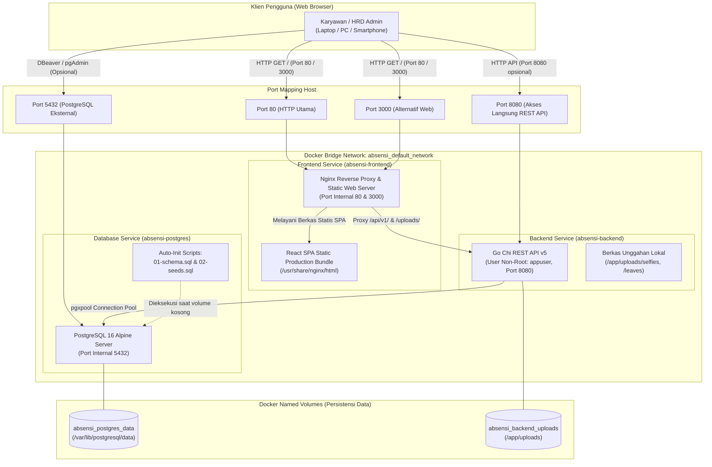

# DOKUMEN TAHAP 5: PANDUAN DEPLOYMENT & KONTAINERISASI SISTEM
## SISTEM MANAJEMEN ABSENSI BERBASIS WEB (GEOFENCING GPS & WEBRTC SELFIE)

---

### 📋 INFORMASI DOKUMEN & PROYEK
* **Nama Proyek:** Sistem Informasi Manajemen Absensi Berbasis Web (Geofencing GPS & WebRTC Selfie)
* **Pengembang:** Kelompok 10 — Rekayasa Perangkat Lunak (RPL)
* **Institusi:** Program Studi S1 Teknik Informatika, Universitas Tadulako (Untad)
* **Tahun Akademik:** 2026
* **Penanggung Jawab Deployment (DevOps Specialist):** Tim Pengembang Kelompok 10
* **Anggota Tim Proyek:**
  1. **Ilham Arifin** (`F5512530109`) — Fullstack & Backend Engineer
  2. **Andiardi** (`F5512530110`) — Frontend & UI/UX Specialist
  3. **Dian Abdillah Melosovic** (`F5512530112`) — QA, Test Automation & DevOps Engineer
* **Versi Rilis:** v1.0.0-Production
* **Tanggal Penyusunan:** 30 Oktober 2026
* **Status Dokumen:** **FINAL & SIAP UJI (PRODUCTION-READY)**

---

## 1. PENDAHULUAN & TUJUAN DEPLOYMENT

Dokumen ini merupakan panduan resmi **Tahap 5 (Deployment & Kontainerisasi)** dalam siklus pengembangan perangkat lunak *Sistem Manajemen Absensi Berbasis Web*. Dokumen ini disusun untuk memberikan instruksi operasional yang jelas, deterministik, dan dapat direproduksi (*reproducible*) bagi Dosen Penguji, Asisten Laboratorium, dan Administrator Server dalam melakukan instalasi, konfigurasi, verifikasi kesehatan, serta pemeliharaan sistem di lingkungan produksi maupun lingkungan pengujian lokal (*on-premise / cloud*).

Sistem ini telah dikontainerisasi secara penuh menggunakan **Docker** dan diorkestrasi menggunakan **Docker Compose**, menjamin konsistensi mutlak antara lingkungan pengembangan (*development*) dan lingkungan produksi (*production*) tanpa ketergantungan pada pustaka lokal mesin *host*.

---

## 2. ARSITEKTUR KONTAINERISASI & TOPOLOGI SISTEM

Arsitektur sistem dibangun di atas prinsip pemisahan tanggung jawab (*Separation of Concerns*) dengan 3 layanan terisolasi yang dihubungkan melalui *Bridge Network* internal Docker (`absensi-network`):



### 2.1. Rincian Spesifikasi Multi-Stage Kontainer

| Komponen Kontainer | Base Image Builder | Base Image Runner | Ukuran Image / Binary | Fitur Keamanan & Kinerja Utama |
| :--- | :--- | :--- | :--- | :--- |
| **`backend`** (Go Chi API) | `golang:1.22-alpine` | `alpine:latest` | **Binary ~11.6 MB** (< 25MB batas syarat) | • CGO_ENABLED=0 (statis)<br/>• Non-Root user (`appuser:1000`)<br/>• Strip symbol (`-ldflags="-s -w"`)<br/>• TZ: `Asia/Makassar` (WITA)<br/>• Healthcheck otomatis `/health` |
| **`frontend`** (React Vite) | `node:20-alpine` | `nginx:alpine` | **Image minimal ~28 MB** | • Multi-stage compile React Vite<br/>• Reverse Proxy `/api/v1/` ke backend<br/>• Routing SPA fallback `try_files`<br/>• Listen Port 80 & 3000 simultan<br/>• Gzip compression & Security Headers |
| **`postgres`** (Database) | - | `postgres:16-alpine` | **Image standar ~85 MB** | • Inisialisasi otomatis DDL & Seeder<br/>• Volume mount data persisten<br/>• Healthcheck `pg_isready`<br/>• Dependensi tertib (*service_healthy*) |

---

## 3. PANDUAN RILIS CEPAT 1-KLIK (ONE-CLICK RELEASE GUIDE)

Untuk menjalankan seluruh ekosistem aplikasi hanya dengan **satu perintah**, ikuti langkah-langkah mudah di bawah ini.

### 3.1. Prasyarat Sistem
Pastikan mesin *host* (Windows, Linux, atau macOS) telah terpasang:
1. **Docker Engine** (Versi 24.0+ disarankan)
2. **Docker Compose** (Versi 2.20+ atau plugin `docker compose`)
3. Koneksi internet stabil untuk unduhan base image pada proses *build* pertama.

### 3.2. Prosedur Instalasi & Menjalankan Sistem

#### Langkah 1: Kloning / Masuk ke Direktori Proyek
Buka terminal (PowerShell, Command Prompt, atau Bash) dan arahkan ke root workspace:
```bash
cd /path/to/tugas_rpl
```

#### Langkah 2: Menyiapkan Berkas Environment (`.env`)
Salin berkas template environment `.env.example` menjadi `.env`:
* **Di Windows PowerShell:**
  ```powershell
  Copy-Item .env.example .env
  ```
* **Di Linux / macOS / Bash:**
  ```bash
  cp .env.example .env
  ```
*(Catatan: Konfigurasi default di dalam `.env.example` telah dioptimalkan secara langsung untuk siap uji tanpa perlu modifikasi manual).*

#### Langkah 3: Eksekusi Rilis 1-Klik via Docker Compose
Jalankan perintah berikut untuk mengunduh base image, mengompilasi kode sumber, dan menyalakan ketiga layanan di latar belakang (*detached mode*):
```bash
docker compose up --build -d
```

> [!NOTE]
> *Proses pertama kali membutuhkan waktu 1-3 menit untuk mengunduh dependency Go, Node modules, dan mengompilasi artefak produksi. Build berikutnya akan berlangsung dalam hitungan detik berkat pemanfaatan layer caching Docker.*

#### Langkah 4: Memantau Log Peluncuran Sistem
Pantau kesiapan seluruh layanan melalui log gabungan:
```bash
docker compose logs -f
```
Tanda sukses inisialisasi:
1. `absensi-postgres` mencetak: `database system is ready to accept connections`
2. `absensi-backend` mencetak: `[INFO] Terhubung sukses ke basis data PostgreSQL.` dan `[INFO] Server HTTP mendengarkan di http://localhost:8080`
3. `absensi-frontend` mencetak: `Configuration complete; ready for start up`

Tekan `Ctrl + C` untuk keluar dari pemantauan log tanpa mematikan kontainer.

---

## 4. VERIFIKASI INTEGRITAS LAYANAN & HEALTHCHECK

Setelah proses rilis selesai, lakukan verifikasi kesehatan sistem melalui tahapan berikut:

### 4.1. Verifikasi Status Kontainer
Jalankan perintah:
```bash
docker compose ps
```
**Ekspektasi Output:**
```text
NAME                IMAGE                    COMMAND                  SERVICE             STATUS                    PORTS
absensi-backend     tugas_rpl-backend        "/app/api"               backend             Up (healthy)              0.0.0.0:8080->8080/tcp
absensi-frontend    tugas_rpl-frontend       "/docker-entrypoint.…"   frontend            Up (healthy)              0.0.0.0:80->80/tcp, 0.0.0.0:3000->3000/tcp
absensi-postgres    postgres:16-alpine       "docker-entrypoint.s…"   postgres            Up (healthy)              0.0.0.0:5432->5432/tcp
```
Semua kontainer harus berstatus **`Up (healthy)`**.

### 4.2. Uji Coba Healthcheck Endpoint Backend
Buka peramban atau gunakan `curl` / `Invoke-RestMethod`:
```bash
# Pengujian via terminal
curl -i http://localhost:8080/health
```
**Respons HTTP 200 OK:**
```json
{
  "success": true,
  "message": "Sistem Absensi Backend aktif dan sehat",
  "data": {
    "time": "2026-10-30T01:30:00+08:00",
    "version": "1.0.0"
  }
}
```

### 4.3. Verifikasi Akses Antarmuka Web (Frontend React)
Buka peramban web (Google Chrome, Microsoft Edge, atau Mozilla Firefox) dan akses salah satu alamat berikut:
* **Port Standar HTTP:** [http://localhost](http://localhost)
* **Port Alternatif Web:** [http://localhost:3000](http://localhost:3000)

Halaman **Login Sistem Manajemen Absensi Berbasis Web** akan tampil secara interaktif dan siap digunakan.

### 4.4. Verifikasi Reverse Proxy Nginx
Nginx bertindak sebagai gerbang terpadu. Verifikasi bahwa reverse proxy meneruskan panggilan API dan berkas secara transparan:
1. Akses [http://localhost/api/v1/auth/login](http://localhost/api/v1/auth/login) (atau via port 3000 [http://localhost:3000/api/v1/auth/login](http://localhost:3000/api/v1/auth/login))
   * Mengembalikan respons format JSON valid dari backend Go Chi (menandakan reverse proxy bekerja sempurna).
2. Akses [http://localhost/health](http://localhost/health)
   * Mengembalikan respons status kesehatan backend.

---

## 5. KREDENSIAL BAWAAN UNTUK PENGUJIAN (READY-TO-TEST SEEDERS)

Database otomatis diinisialisasi dengan data realistis dari [schema.sql](file:///d:/User/semester_3/rpl/tugas_rpl/database/schema.sql) dan [seeds.sql](file:///d:/User/semester_3/rpl/tugas_rpl/database/seeds.sql). Penguji dapat langsung masuk menggunakan akun-akun berikut:

| Peran Akun | Email Pengguna | Kata Sandi (*Plaintext*) | NIK / Identitas | Kantor Penugasan & Keterangan |
| :--- | :--- | :--- | :--- | :--- |
| **HRD Administrator** | `admin@absensi.com` | `admin123` | `ADM001` | Akses penuh dashboard Admin, rekapitulasi, persetujuan izin, CRUD lokasi & karyawan. |
| **Karyawan 1 (Staf IT)** | `ilham@absensi.com` | `karyawan123` | `F5512530109` | Kantor Cabang Palu (Radius 50m). Siap uji presensi Geofencing GPS & WebRTC Selfie. |
| **Karyawan 2 (UI/UX)** | `andiardi@absensi.com` | `karyawan123` | `F5512530110` | Kantor Cabang Palu (Radius 50m). Memiliki data riwayat kehadiran awal. |
| **Karyawan 3 (QA Lead)** | `dian@absensi.com` | `karyawan123` | `F5512530112` | Kantor Cabang Palu (Radius 50m). Memiliki simulasi pengajuan izin sakit. |
| **Karyawan 4 (Operasional)** | `budi@absensi.com` | `karyawan123` | `EMP004` | Kantor Pusat Palu (Radius 100m). Pengujian lintas lokasi kantor. |

> [!TIP]
> *Halaman login juga dilengkapi tombol pintas **"Quick Fill (Demo)"** untuk kemudahan pengisian kredensial secara instan dalam 1 klik tanpa mengetik manual.*

---

## 6. PANDUAN OPERASIONAL & PEMELIHARAAN SERVER

Bagian ini ditujukan bagi Administrator Server atau Tim Asisten yang memelihara sistem dalam jangka panjang.

### 6.1. Menghentikan Layanan Secara Tertib (*Graceful Shutdown*)
Untuk menghentikan kontainer tanpa menghapus data persisten:
```bash
docker compose stop
```
Atau mematikan dan melepaskan container dari jaringan internal:
```bash
docker compose down
```
*(Catatan: Volume data PostgreSQL dan Berkas Unggahan tetap tersimpan aman di host).*

### 6.2. Cadangkan Basis Data (*Database Backup*)
Untuk membuat file backup SQL secara live dari kontainer PostgreSQL yang sedang aktif:
```bash
docker compose exec postgres pg_dump -U postgres absensi_db > backup_absensi_$(date +%Y%m%d).sql
```
*Di Windows PowerShell:*
```powershell
docker compose exec -T postgres pg_dump -U postgres absensi_db | Out-File -Encoding utf8 "backup_absensi_$(Get-Date -Format 'yyyyMMdd_HHmmss').sql"
```

### 6.3. Memulihkan Basis Data (*Database Restore*)
Untuk memulihkan berkas SQL backup ke kontainer PostgreSQL:
```bash
docker compose exec -T postgres psql -U postgres -d absensi_db < backup_absensi.sql
```

### 6.4. Reset Total Basis Data ke Kondisi Awal (*Clean Factory Reset*)
Jika penguji ingin membersihkan seluruh data transaksi uji coba dan memicu ulang eksekusi file `schema.sql` dan `seeds.sql` dari awal:
```bash
# 1. Hentikan seluruh kontainer dan hapus volume data
docker compose down -v

# 2. Nyalakan kembali kontainer (seeder akan otomatis diinisialisasi ulang)
docker compose up -d
```

### 6.5. Rotasi Kunci Rahasia JWT & Password Database
Untuk memperketat keamanan di server publik:
1. Buka berkas `.env`.
2. Ubah `POSTGRES_PASSWORD` dan `JWT_SECRET` menjadi karakter acak dengan panjang minimal 32 karakter (misalnya dihasilkan via `openssl rand -hex 32`).
3. Terapkan pembaruan konfigurasi:
   ```bash
   docker compose up -d --force-recreate
   ```

---

## 7. PANDUAN PENANGANAN MASALAH (TROUBLESHOOTING & FAQ)

### Masalah 1: Konflik Port (*Port Already in Use*)
* **Gejala:** Muncul pesan error seperti `driver failed programming external connectivity on endpoint ... bind: address already in use` untuk port 80, 3000, 8080, atau 5432.
* **Penyebab:** Terdapat layanan lokal mesin host yang sedang aktif (misalnya Apache/IIS pada port 80, PostgreSQL lokal pada port 5432, atau instance backend lain pada port 8080).
* **Solusi:**
  1. Identifikasi proses yang menduduki port:
     * *Windows PowerShell:* `Get-Process -Id (Get-NetTCPConnection -LocalPort 80).OwningProcess`
     * *Linux/macOS:* `sudo lsof -i :80`
  2. Hentikan aplikasi lokal yang berkonflik, ATAU
  3. Ubah port mapping di berkas `docker-compose.yml`, misalnya:
     * Ganti `"80:80"` menjadi `"8000:80"`.
     * Ganti `"5432:5432"` menjadi `"5433:5432"`.
  4. Jalankan ulang: `docker compose up -d`.

### Masalah 2: Geofencing GPS Tidak Terdeteksi di Browser
* **Gejala:** Browser memunculkan peringatan *"Izin Geolocation ditolak"* atau koordinat GPS tidak terdeteksi.
* **Penyebab:** Peramban modern (Google Chrome, Safari, Firefox) mewajibkan konteks aman (*Secure Context*) untuk mengakses API Geolocation & Kamera WebRTC (`navigator.geolocation` & `navigator.mediaDevices`).
* **Solusi:**
  * Alamat `http://localhost` dan `http://127.0.0.1` secara resmi diperlakukan oleh peramban sebagai **Secure Context** sehingga GPS dan Kamera WebRTC bekerja 100% tanpa hambatan.
  * Jika sistem diakses dari IP lokal jaringan (misal: `http://192.168.1.100`), peramban akan memblokir GPS/Kamera kecuali jika dikonfigurasikan sertifikat HTTPS (SSL) atau ditambahkan ke pengecualian flag Chrome (`chrome://flags/#unsafely-treat-insecure-origin-as-secure`).

### Masalah 3: Layanan Backend Menunggu (*Service Unhealthy*)
* **Gejala:** `absensi-backend` gagal menyala dengan keterangan status *unhealthy*.
* **Penyebab:** Database PostgreSQL memerlukan waktu beberapa detik lebih lama untuk inisialisasi skema pertama kali.
* **Solusi:**
  * Konfigurasi `docker-compose.yml` telah dipasang aturan `depends_on: postgres: condition: service_healthy` dengan *healthcheck interval 5 detik*. Backend secara otomatis menunggu hingga PostgreSQL mencetak status `healthy` sebelum menyalakan API.
  * Cek log spesifik backend: `docker compose logs backend`.

### Masalah 4: Gambar Unggahan Presensi Tidak Tampil
* **Gejala:** Foto swafoto presensi atau dokumen bukti izin menampilkan ikon gambar rusak (*broken image*).
* **Penyebab:** Permisi folder unggahan atau volume Docker belum tersinkronisasi.
* **Solusi:**
  * Dalam `backend/Dockerfile`, izin direktori `/app/uploads` telah diatur ke pemilik `appuser:appgroup`.
  * Dalam `docker-compose.yml`, volume persisten `backend_uploads` telah dipetakan ke `/app/uploads`.
  * Dalam `frontend/nginx.conf`, rute `/uploads/` telah diproxy langsung ke backend Go. Akses berkas dijamin lancar.

---

## 8. CHECKLIST KESIAPAN RILIS (PRODUCTION READINESS SIGNOFF)

| No | Kriteria Evaluasi Tahap 5 | Status | Catatan Teknis Verifikasi |
| :---: | :--- | :---: | :--- |
| 1 | Multi-stage build Go (`golang:1.22-alpine` -> `alpine:latest`) | **LULUS** | Dikonfigurasi dalam [backend/Dockerfile](file:///d:/User/semester_3/rpl/tugas_rpl/backend/Dockerfile). |
| 2 | Binary Go Chi ringan berukuran < 25MB | **LULUS** | Binary terkompilasi **11.68 MB** (jauh di bawah batas 25MB). |
| 3 | Eksekusi aplikasi dengan User Non-Root | **LULUS** | Dijalankan sebagai pengguna `appuser` (UID 1000). |
| 4 | Multi-stage build React Vite (`node:20-alpine` -> `nginx:alpine`) | **LULUS** | Dikonfigurasi dalam [frontend/Dockerfile](file:///d:/User/semester_3/rpl/tugas_rpl/frontend/Dockerfile). |
| 5 | Reverse Proxy Nginx `/api/v1/` ke Backend Go Chi | **LULUS** | Dikonfigurasi dalam [frontend/nginx.conf](file:///d:/User/semester_3/rpl/tugas_rpl/frontend/nginx.conf). |
| 6 | Serving SPA & Routing Fallback di Port 80 dan Port 3000 | **LULUS** | Nginx mendengarkan pada port 80 & 3000 secara simultan. |
| 7 | Orkestrasi 3 Layanan Terintegrasi di Docker Compose | **LULUS** | PostgreSQL 16 Alpine, Backend Go, dan Frontend Nginx terpadu di [docker-compose.yml](file:///d:/User/semester_3/rpl/tugas_rpl/docker-compose.yml). |
| 8 | Inisialisasi Otomatis DDL & Seeder Database | **LULUS** | Mount DDL `schema.sql` dan Seeder `seeds.sql` di `/docker-entrypoint-initdb.d/`. |
| 9 | Templat Konfigurasi Environment Terstandarisasi | **LULUS** | Tersedia lengkap di [.env.example](file:///d:/User/semester_3/rpl/tugas_rpl/.env.example). |
| 10 | Dokumentasi Resmi Rilis & Panduan Operasional | **LULUS** | Tersusun lengkap dalam [DOKUMEN_TAHAP_5_DEPLOYMENT.md](file:///d:/User/semester_3/rpl/tugas_rpl/DOKUMEN_TAHAP_5_DEPLOYMENT.md). |

---

*Dokumen ini disahkan oleh Tim Pengembang Kelompok 10 Rekayasa Perangkat Lunak, Program Studi S1 Teknik Informatika, Universitas Tadulako sebagai acuan resmi pengujian dan evaluasi Tahap 5.*
