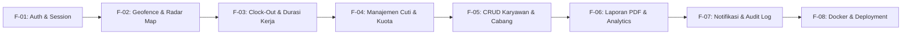

# DRAFT RENCANA PENGEMBANGAN FITUR (FINAL VERSION)
## SISTEM MANAJEMEN ABSENSI BERBASIS WEB (GEOFENCING & WEBRTC SELFIE)

> **Proyek:** Rekayasa Perangkat Lunak - Kelompok 10 (Universitas Tadulako 2026)  
> **Anggota:** Ilham Arifin, Andiardi, Dian Abdillah Melosovic  
> **Tema Visual:** Aesthetic Retro Manga Bento (Neo-Brutalist Soft UI)  
> **Tech Stack:** Go Chi + Raw SQL pgx/v5 (Backend), React 18+ Vite Tailwind (Frontend), PostgreSQL (Database)

---

## 🧭 Roadmap Transisi: MVP Menuju Versi Final

Versi MVP telah berhasil membuktikan fungsi inti (*proof of concept*): validasi geofencing Haversine, live kamera WebRTC, evaluasi keterlambatan, pengajuan izin, dan ekspor CSV. 

Pada **Versi Final (Production-Ready)**, aplikasi akan ditingkatkan dari segi kelengkapan fitur bisnis (*feature completeness*), keamanan tingkat produksi (*enterprise security*), pengalaman pengguna (*UX polish*), serta kesiapan rilis (*deployment automation*).

---

## 📌 DAFTAR MODUL FITUR PENGEMBANGAN (BY FITUR)

---

### 1. FITUR F-01: Sistem Otentikasi & Manajemen Sesi Terproteksi
Meningkatkan alur login dari simulator menjadi sistem login nyata dengan halaman gerbang (*login gate*) dan proteksi rute.

* **Kondisi MVP:** Menggunakan switcher mode di header dengan akun login bawaan (*pre-authenticated mock/state*).
* **Peningkatan Versi Final:**
  - Halaman Login mandiri (`/login`) bergaya Retro Manga dengan validasi kredensial (Email/NIK + Password Bcrypt).
  - Penyimpanan JWT Token yang aman di `localStorage` / `HttpOnly Cookie`.
  - State session global (React Context / Zustand) dengan *Route Guard* (`<ProtectedRoute>`):
    * Karyawan hanya bisa mengakses portal presensi dan riwayat pribadi.
    * Admin diarahkan otomatis ke dashboard manajemen.
  - Fitur Ubah Kata Sandi (*Change Password*) dan Tombol Keluar (*Logout*) yang membersihkan sesi.
* **Kriteria Penerimaan (DoD):**
  - Pengguna yang belum login otomatis dialihkan ke halaman `/login`.
  - Percobaan akses halaman admin oleh akun karyawan mengembalikan status tidak diizinkan.

---

### 2. FITUR F-02: Radar Geofencing Interaktif & Deteksi Akurasi GPS
Mengintegrasikan koordinat GPS perangkat nyata dengan visualisasi radar peta mini dan pencegahan kecurangan (*anti-spoofing*).

* **Kondisi MVP:** Menggunakan kalkulasi Haversine statis dan tombol uji simulasi jarak (18m vs 340m).
* **Peningkatan Versi Final:**
  - Pemantauan GPS waktu-nyata berkelanjutan menggunakan `navigator.geolocation.watchPosition` dengan opsi `enableHighAccuracy: true`.
  - **Threshold Akurasi GPS:** Sistem menolak koordinat jika akurasi perangkat (`coords.accuracy`) > 100 meter guna mencegah kecurangan triangulasi seluler kasar.
  - **Widget Radar Peta Mini (Mini-Map):** Peta interaktif ringkas (Leaflet / SVG radar bergaya komik monokrom) yang menampilkan titik kantor acuan, lingkaran batas radius 50m, dan posisi pin karyawan saat ini.
* **Kriteria Penerimaan (DoD):**
  - Pin lokasi pengguna bergerak dinamis mengikuti koordinat GPS nyata.
  - Tombol presensi hanya aktif jika jarak $\le 50\text{m}$ DAN akurasi GPS $\le 100\text{m}$.

---

### 3. FITUR F-03: Presensi Pulang (Clock-Out) & Kalkulasi Durasi Jam Kerja
Melengkapi siklus kerja harian karyawan dengan presensi pulang dan penghitungan otomatis jam kerja efektif.

* **Kondisi MVP:** Fokus pada presensi masuk (Clock-In) dan status masuk.
* **Peningkatan Versi Final:**
  - Logika dinamis pada tombol utama:
    * Jika belum presensi masuk: Menampilkan tombol **"Presensi Masuk"**.
    * Jika sudah presensi masuk namun belum presensi pulang: Menampilkan tombol **"Presensi Pulang"** (aktif setelah jam masuk selesai).
    * Jika sudah masuk dan pulang: Menampilkan kartu **"Kehadiran Hari Ini Selesai"**.
  - Evaluasi status pulang:
    * Pulang sebelum jam jadwal (cth: < 17:00 WITA) $\rightarrow$ Status `PULANG_CEPAT`.
    * Pulang tepat waktu $\ge 17:00\text{ WITA}$ $\rightarrow$ Status `PULANG_NORMAL`.
  - Penghitungan otomatis durasi kerja efektif (misal: *8 jam 24 menit*) dan akumulasi lembur (*overtime*) jika ada penugasan.
* **Kriteria Penerimaan (DoD):**
  - Riwayat harian memuat 2 rekaman waktu (Masuk & Pulang) beserta durasi kerja total.

---

### 3B. FITUR F-03B: Halaman Riwayat & Kalender Kehadiran Mandiri Karyawan
Menyediakan antarmuka khusus bagi karyawan untuk meninjau rekapitulasi kehadiran dan bukti swafoto bulanannya secara mandiri.

* **Kondisi MVP:** Tombol navigasi bawah *"Riwayat"* hanya memunculkan dialog ringkasan *alert* teks sederhana.
* **Peningkatan Versi Final:**
  - **Tampilan Khusus Halaman Riwayat (Bento Timeline):**
    * Navigasi tab bawah beralih langsung ke tampilan layar penuh Riwayat Kehadiran.
    * **Filter Pemilih Periode:** Dropdown pemilihan bulan & tahun (cth: Oktober 2026, September 2026).
    * **Kartu Akumulasi Bulanan Bento:**
      - Total Hari Hadir (LCD numerik).
      - Total Tepat Waktu vs Terlambat.
      - Total Izin / Sakit.
      - Rata-rata Jam Kerja Harian.
    * **Daftar Catatan Harian (Daily Feed):** Setiap hari ditampilkan dalam bentuk kartu bento retro:
      - Kapsul tanggal & nama hari (`28 OKT`, `RABU`).
      - Jam Masuk & Jam Pulang berformat font LCD digital.
      - Durasi total jam kerja hari itu (misal: `8 jam 57 mnt`).
      - Badge status kehadiran (`🟢 TEPAT WAKTU`, `🟡 TERLAMBAT (9m)`, `🟣 IZIN SAKIT`).
      - Tombol **"Lihat Foto"** untuk membuka modal swafoto dan bukti koordinat GPS yang terekam pada hari tersebut.
* **Kriteria Penerimaan (DoD):**
  - Karyawan dapat menelusuri seluruh riwayat presensi bulan aktif maupun bulan lalu.
  - Setiap rekaman menampilkan waktu, status, dan bukti foto autentik secara mandiri tanpa harus meminta ke admin HRD.

---

### 4. FITUR F-04: Manajemen Kuota Cuti & Pratinjau Bukti Medis
Memperdalam modul perizinan (*leave management*) agar sesuai dengan standar tata kelola HRD perusahaan.

* **Kondisi MVP:** Formulir izin dasar dan review admin (Setujui / Tolak).
* **Peningkatan Versi Final:**
  - **Sistem Saldo/Kuota Cuti Tahunan:** Setiap karyawan memiliki alokasi cuti (misal: 12 hari/tahun). Saldo berkurang otomatis ketika pengajuan disetujui.
  - **Pengecekan Hari Kerja:** Sistem menghitung durasi izin dengan mengecualikan hari libur akhir pekan (Sabtu & Minggu).
  - **Pratinjau Dokumen Medis:** Fitur modal untuk Admin/HRD melihat berkas surat dokter / surat dinas langsung (PDF viewer & image zoom) sebelum menyetujui atau menolak.
* **Kriteria Penerimaan (DoD):**
  - Karyawan tidak dapat mengajukan cuti melebihi sisa saldo kuota tahunannya.
  - Admin dapat membuka berkas bukti surat langsung dari dashboard.

---

### 5. FITUR F-05: Modul Penuh CRUD Karyawan & Titik Kantor Cabang
Memberikan kendali penuh kepada Admin/HRD untuk mengelola staf dan cabang kantor tanpa harus menyentuh database secara manual.

* **Kondisi MVP:** Data karyawan dan lokasi kantor diatur melalui seeder dan mock store.
* **Peningkatan Versi Final:**
  - **Kelola Karyawan (Admin):**
    * Tambah karyawan baru (NIK, Nama, Email, Jabatan, Role, Kantor Penugasan, Jadwal Kerja Masuk/Pulang).
    * Edit profil dan jadwal khusus per karyawan.
    * Nonaktifkan akun karyawan (Soft delete / `status_aktif = false`) sehingga tidak bisa login lagi saat keluar perusahaan.
  - **Kelola Lokasi Kantor (Admin):**
    * Tambah kantor/cabang baru dengan input koordinat Latitude, Longitude, dan Radius Batas.
    * Tombol *"Ambil Lokasi Saat Ini"* untuk memudahkan Admin mendaftarkan titik koordinat kantor langsung di tempat.
* **Kriteria Penerimaan (DoD):**
  - Admin dapat menambah, mengubah, dan menonaktifkan karyawan dan kantor cabang langsung dari antarmuka web.

---

### 6. FITUR F-06: Analitik Kehadiran & Ekspor Laporan Resmi (PDF Cetak)
Menyediakan laporan profesional siap cetak untuk pimpinan perusahaan atau dosen penguji.

* **Kondisi MVP:** Tampilan tabel dasbor dan ekspor file CSV.
* **Peningkatan Versi Final:**
  - **Grafik Tren Kehadiran (Analytics Chart):** Grafik batang dan lingkaran (*bar & doughnut chart*) persentase kehadiran tepat waktu vs terlambat vs izin dalam 30 hari terakhir.
  - **Ekspor Dokumen PDF Resmi:** Format cetak PDF (*Print-ready letterhead*) yang memuat:
    * Kop resmi perusahaan / instansi.
    * Periode laporan dan filter departemen.
    * Tabel rekapitulasi kehadiran (Total Hadir, Terlambat, Izin, Alpha).
    * Kolom tanda tangan digital pimpinan HRD.
* **Kriteria Penerimaan (DoD):**
  - Berkas PDF yang diunduh rapi, terformat ukuran kertas A4, dan siap dicetak sebagai laporan resmi.

---

### 7. FITUR F-07: Pusat Notifikasi & Rekam Jejak Audit (*Audit Trail*)
Meningkatkan transparansi operasional antara manajemen dan pegawai.

* **Kondisi MVP:** Dialog peringatan standar (*alert/modal* konfirmasi).
* **Peningkatan Versi Final:**
  - **Pusat Notifikasi Karyawan:** Notifikasi in-app saat pengajuan izin disetujui atau ditolak oleh HRD.
  - **Audit Log Koreksi Kehadiran:** Jika Admin melakukan koreksi status presensi (misal dari *Terlambat* menjadi *Tepat Waktu* karena kendala teknis), sistem mencatat:
    * NIK Admin pengubah.
    * Waktu perubahan dilakukan.
    * Alasan resmi koreksi.
    * Riwayat nilai sebelum dan sesudah koreksi.
* **Kriteria Penerimaan (DoD):**
  - Riwayat koreksi tersimpan permanen dan dapat ditinjau oleh Super Admin.

---

### 8. FITUR F-08: Kontainerisasi Docker & Kesiapan Rilis (Deployment)
Mengemas seluruh aplikasi ke dalam kontainer mandiri sehingga dapat dijalankan di server manapun hanya dengan 1 baris perintah.

* **Kondisi MVP:** Dijalankan secara lokal via terminal `go run` dan `npm run dev`.
* **Peningkatan Versi Final:**
  - `backend/Dockerfile`: Multi-stage build Golang (menghasilkan binary berukuran ringan < 25MB berbasis Alpine Linux).
  - `frontend/Dockerfile`: Multi-stage build React + Nginx (menghasilkan web server static berperforma tinggi dengan reverse proxy API).
  - `docker-compose.yml`: Menyatukan 3 layanan utama (PostgreSQL 16 + Backend Go + Frontend Nginx) dengan *network bridge* terisolasi, persistensi volume basis data, dan script *healthcheck* otomatis.
  - File `.env.example` terstandarisasi untuk lingkungan produksi.
* **Kriteria Penerimaan (DoD):**
  - Aplikasi dapat dijalankan dengan perintah `docker compose up --build` dan langsung aktif di `http://localhost`.

---

## 📊 Matriks Prioritas Pengembangan

| Prioritas | Kode Fitur | Nama Modul Fitur | Perkiraan Bobot | Target Dampak |
| :---: | :---: | :--- | :---: | :--- |
| **P1** | **F-01** | Otentikasi Nyata & Proteksi Rute (Login Gate) | Sedang | Keamanan hak akses pengguna |
| **P1** | **F-03** | Presensi Pulang & Durasi Kerja Efektif | Sedang | Kelengkapan siklus presensi harian |
| **P1** | **F-03B**| Halaman Riwayat & Kalender Kehadiran Karyawan | Sedang | Transparansi & audit mandiri pegawai |
| **P2** | **F-05** | CRUD Data Karyawan & Titik Kantor Cabang | Menengah | Kemandirian operasional admin |
| **P2** | **F-04** | Alur Cuti Lanjutan & Pratinjau Surat Dokter | Menengah | Validitas bukti izin |
| **P3** | **F-06** | Analitik Grafik & Ekspor Laporan PDF Cetak | Menengah | Presentasi laporan ke pimpinan/dosen |
| **P3** | **F-02** | Radar Peta Mini Geofence & Anti-Mock GPS | Sedang | Visualisasi interaktif anti-curang |
| **P4** | **F-08** | Packaging Docker Compose & Panduan Rilis | Menengah | Penuntasan Tahap 5 Deployment |
